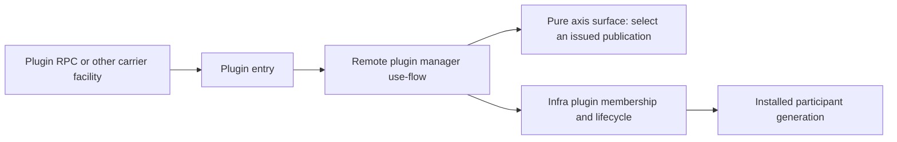
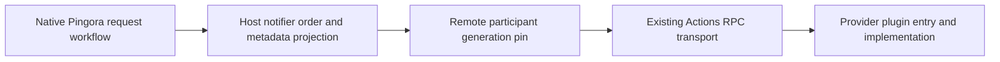

# Remote plugins and axis ingress

The plugin axis owns its ingress. Its runtime path is:



Worker application ingress and worker management are separate. Remote plugin
operations never mount through `SharedEntry` or its `install_actions` method.
Reusing an RPC carrier does not mean reusing the host application's entry or router.

The previous implementation had only a map of outbound connections. That was not
a plugin manager. `RemotePluginManager` now owns installed participant identities,
issued hook grants, activation generations, withdrawal and retirement. It reuses
infra `PluginManager<T>`, which in turn reuses `Installation`, `Provider`, `Runtime`,
admission gates and inverse cleanup. The manager does not create another notifier
chain or change callback registration order.

The worker request path still uses native Pingora:



The pure axis surface selects only host-issued participants and hooks. Existing
metadata projection and reply validation enforce header grants and decisions for
both direct and remote bindings. The remote caller cannot widen either grant.

## Configuration

```json
{
  "upstream": "http://127.0.0.1:8080",
  "axis_bindings": {
    "request_policy": {
      "endpoint": "unix:///run/pingora-worker/policy.sock",
      "max_inflight": 32,
      "connect_timeout_ms": 5000,
      "shutdown_timeout_ms": 5000
    }
  },
  "plugin_ingress": {
    "listen": "unix:///run/pingora-worker/plugins.sock"
  },
  "callbacks": [{
    "axis": "request_policy",
    "registration": "policy",
    "package": "example.policy",
    "hooks": ["before_upstream_send"],
    "headers": ["x-request-id"],
    "patch_headers": ["x-policy"],
    "timeout_ms": 5000
  }]
}
```

`axis_bindings.endpoint` is the outbound provider endpoint. `plugin_ingress.listen`
is the optional incoming plugin control endpoint. They are different responsibilities.
Omitting `plugin_ingress` opens no plugin listener. Its dedicated router does not
expose `worker.get`, `worker.apply`, metrics, configuration or native Tool actions.
Worker management does not expose the plugin routes. Configuration rejects using
the same address for plugin ingress and worker management or data ingress.

Both directions accept Unix sockets or loopback TCP. Deployment controls local
endpoint access and peer identity. Loopback alone does not authenticate a peer.
The listener reuses infra socket leases, route publication and `ActionListener`;
there is one authoritative listener for each configured operation.

| Binding selection | Result |
| --- | --- |
| Omitted or `remote` | RPC; requires a configured axis and registration |
| `direct` | Existing native or optional Wasm artifact path |
| Explicit `auto`, Rust or Go | Direct using the integrated native ABI bridge |
| Explicit `auto`, Python or JavaScript | RPC; the interpreter retains its own scheduler |

Existing native/Wasm entries must set `"binding": "direct"`. `backend: "native"`
selects an artifact backend, not a binding. A failed RPC connection never silently
loads a local artifact. A bridge tested elsewhere in infra does not establish a
working direct bridge inside this worker.

## Plugin operations

The dedicated entry reuses `infra.actions.v1.Actions/Call` with these bindings:

| Binding | Input | Effect |
| --- | --- | --- |
| `plugin.get` | `axis`, `registration` | Read publication availability, contract, manager incarnation and registration generation |
| `plugin.activate` | `axis`, `registration`, `incarnation` | Reinstall a host-declared, withdrawn slot with its original grant |
| `plugin.withdraw` | `axis`, `registration`, `incarnation`, `generation` | Fence the exact installed generation and drain its local calls |

All fields are JSON. Unknown fields are rejected. Controls cannot supply an
endpoint, artifact, hook list, header list or new registration. Input/output is
limited to 1 KiB, at most 32 concurrent control calls, and a 30-second local deadline.
Use `plugin.get` before a mutation. The random manager incarnation rejects controls
from a prior worker instance. The registration generation rejects withdrawal of a
replacement. These values are concurrency coordinates, not authentication secrets.

Callbacks fail closed while their selected slot is unavailable. Reactivation uses
the same notifier position and grants. `available: false` includes withdrawn,
warming, retiring or quarantined registrations; it is not a detailed lifecycle
report. A control timeout can have an unknown outcome. Query state before deciding
whether to retry; timeout does not undo a completed activation or withdrawal.

## Outbound provider contract and replacement

Providers expose `infra.actions.v1.Actions/Call` from their own plugin entry. The
binding is `worker.metadata.v1.<registration>.<hook>`. The input contains version,
hook, request ID, peer IP when present, method, path without query, status,
reuse/completion state, granted headers and selected network metadata. The reply
uses version 1 `decision`, `set_headers` and `remove_headers`. The host checks hook
support, decisions, versions, patch limits, header syntax and protected fields.
The configured package name is identity, not an authentication claim from the peer.

The metadata profile is capped at 64 KiB. It carries no bodies, streaming deltas,
shared-memory custody, socket FDs, pointers or borrowed native objects. Remote
message-codec grants remain rejected. Native Pingora owns body flow, connection
pooling, HTTP/2 keepalive and protocol parsing.

Host code can replace an outbound connection without changing membership:

```rust,ignore
proxy.remote_plugins()
    .replace("request_policy", "unix:///run/pingora-worker/policy-next.sock")
    .await?;
```

Replacement connects before publication. Failure leaves the previous client active.
Admitted calls retain their previous client. The replacement method is not exposed
by plugin ingress. It changes no registration identity, grant or notifier order.

Each callback pins a registration inside an owned async task until its local RPC
exchange settles. Dropping a caller does not release that pin early. Withdrawal
closes admission before draining. Shutdown retires plugin ingress, notifiers and
membership before releasing transports. Failed inverses remain retained and consume
capacity. Remote execution can outlive a local deadline; this implementation does
not claim remote cancellation, process join or shared-memory reclamation.

## Source ownership and validation limits

The plugin entry decodes wire values. The worker manager owns plugin operations and
interprets configuration. The surface owns pure publication selection. Infra owns
membership lifecycle, transport generations, action routing and socket lifecycle.
Async actions share the existing router's validation and owned-call boundary;
native synchronous actions retain their blocking execution path.

This corrects the previous host-entry guidance using the supplied export 7 design
discussions. These documents are design inputs, not execution evidence. The current
integration tests exercise separate real Unix sockets, withdrawal/reactivation,
stale incarnation and generation rejection, fixed grants, dynamic connection
replacement and rollback. They do not establish throughput or remote authorization.

Remaining limits include no provider capability negotiation, no authenticated
cross-host transport, no bulk RPC/shared-memory binding, no full lifecycle state
API, and no measured production throughput or tail latency. Native libraries remain
trusted host code. Checker ownership declarations cannot prove these runtime
properties without source and execution evidence.
