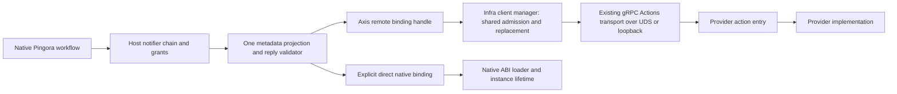

# Remote axis bindings

Worker callbacks default to the `remote` binding. Assembly installs one remote
client manager for each configured axis. All participants on that axis share its
connection generation and admission budget. The worker's notifier chain remains
the only authority for hook order, exposure, decisions and header changes.

This implementation supports the version 1 **metadata-only** profile. Each call
contains at most 64 KiB of owned control data. It carries no body, socket FD,
process pointer, shared-memory reference or borrowed native object. Remote message
codec grants fail validation. Streaming delta events remain outside callbacks.



The diagram shows runtime calls. Source ownership remains separate:

| Responsibility | Owner |
| --- | --- |
| Pingora protocol parsing, connection pool, HTTP/2 PING and native body flow | Pingora and existing infra Pingora facilities |
| Pure hook contracts and exposure types | `proxy_pingora::worker::surface` and worker `ProxyContract` |
| Callback invocation, ordering and admission state | `proxy_pingora::worker::NotifierChain` in the infra dispatch owner |
| Metadata projection, header grants and reply checks | Worker `native_notifier` |
| Binding policy, axis selection and registration identity | Worker config and assembly |
| Connection replacement, transport admission and local call drain | Infra `network_actions::client::RemoteBindings` |
| RPC framing, correlation and receive dispatch | Existing tonic Actions carrier and action router |
| Resource shutdown order and rollback | Existing infra plugin lifecycle composition |
| Native artifact ABI, instance affinity and outstanding native call pins | Existing infra plugin loading |

A remote participant does not create a second notifier registry. Its registration
is a host-assigned name for the admitted methods. Connection replacement changes
no grant, hook list or participant order. The peer cannot install another callback
or grant itself another field through a reply.

## Configuration and migration

```json
{
  "upstream": "http://127.0.0.1:8080",
  "axis_bindings": {
    "request_policy": {
      "endpoint": "unix:///run/pingora-worker/policy.sock",
      "max_inflight": 32,
      "connect_timeout_ms": 5000,
      "shutdown_timeout_ms": 5000
    }
  },
  "callbacks": [{
    "axis": "request_policy",
    "registration": "policy",
    "package": "example.policy",
    "hooks": ["before_upstream_send"],
    "headers": ["x-request-id"],
    "patch_headers": ["x-policy"],
    "timeout_ms": 5000
  }]
}
```

The endpoint must be a Unix socket or loopback TCP address. Deployment owns peer
identity and endpoint access. There is no remote package-loading handshake.
`package` remains configuration identity; it is not an authentication claim from
the peer. An unreachable configured axis fails assembly before data-path service.
Registration names are unique within an axis. Identical names on separate axes
are independent. Names accept ASCII letters, digits, `_` and `-`, up to 64 bytes.

Existing `.so` and Wasm entries must add `"binding": "direct"`. Keep the existing
`backend`, artifact identity, initialization, graph, scheduling and pool settings.
`backend: "native"` selects an artifact backend; it does not select direct execution.
There is no automatic fallback from a failed remote connection to a local artifact.

| Binding selection | Result |
| --- | --- |
| Omitted or `remote` | RPC, for every language; requires an axis and registration |
| `direct` | Existing native or optional Wasm path; requires a local artifact |
| `auto`, Rust or Go | Direct, using the worker's implemented native ABI bridge |
| `auto`, Python or JavaScript | RPC; each interpreter retains its own scheduler |

`auto` is an explicit policy choice, not a claim that all native language bridges
have equivalent behavior. Direct Python and JavaScript are rejected. The worker
has no compiled bridge for these profiles. A future bridge must prove its context,
cancellation, completion and ownership behavior before this policy can change.

For remote callbacks, `timeout_ms` bounds the local exchange. `max_inflight` on the
axis bounds all its participants together and rejects excess calls immediately.
Nondefault native admission, queue, startup, shutdown and scheduling settings
are rejected on remote callbacks. Configure these bounds on the axis. Artifact paths, initialization, native action publication, explicit
in-process execution and message codec grants are rejected on remote callbacks.

## Provider contract

The provider exposes the existing `infra.actions.v1.Actions/Call` service. The
method binding is `worker.metadata.v1.<registration>.<hook>`. The endpoint identifies
the axis; two axes do not need different action names. Providers can use the
existing `SharedEntry::install_actions`, action router and Actions carrier. They
do not need a new worker-specific socket protocol.

The input JSON is the existing worker metadata projection: version, hook,
request ID, socket peer IP when available, method, path without query, status,
reuse/completion state, selected headers and optional network metadata. Only
headers in the host's `headers` grant are included. Bodies never enter this input.
The reply uses the same version 1 `decision`, `set_headers` and `remove_headers`
fields as the direct binding. The existing validator enforces supported decisions,
patch count, header syntax, protected headers and the host's write grant.

The host awaits the semantic result before continuing the hook. Queue admission
alone is not a completed decision. Both bindings use the same hook support checks,
reply parser and grant enforcement. Native borrowing remains local to the direct
binding; the remote profile uses owned control buffers.

## Replacement and shutdown

An assembled `NativeProxy` exposes its stable `remote_bindings()` handle:

```rust,ignore
proxy.remote_bindings()
    .replace("request_policy", "unix:///run/pingora-worker/policy-next.sock")
    .await?;
```

Replacement connects the new client before changing the active generation. If
connection fails, the old client remains active. Calls already admitted retain
their previous client. Later calls use the new client. Replacement does not replay
an old call, change registration identity or widen access. It does not restart the
worker or rebuild its notifier chain. The API is host-controlled; no public
management action is installed for replacement.

Shutdown removes notifier resources before the remote axis owner. The manager
rejects new calls and drains admitted local exchanges within the configured
shutdown deadline. A local deadline or cancelled waiter does not prove that the
provider stopped executing. The transport never retries an ambiguous request.
A successful RPC reply is semantic completion; a timed-out remote operation can
have an unknown outcome. This profile transfers no shared-memory custody, so
local owned buffer release does not depend on a peer release acknowledgement.

Native in-process calls retain their existing native completion pins. Shared
memory would need separate lease, generation and completion evidence. The C and
TypeScript mechanisms in the companion infra do not establish a compiled Rust
bulk-payload binding. This implementation does not claim that integration.

## Reference decisions and validation

The architecture follows the supplied ChatGPT export 7 discussions, especially
`ChatGPT-Branch_·_Review_Plugin_Architecture.md` (one semantic contract, one listener
authority, explicit binding completion and mature native bridge policy) and
`ChatGPT-Socket共享方案.md` (one receive authority and explicit framing). These are
design inputs, not test evidence. Remote clients use the existing framed gRPC
carrier; sharing an axis does not mean that plugin readers compete on one raw
socket or that socket reads provide broadcast delivery.

The implementation reuses Pingora body flow, connection pooling, lifecycle and
protocol controls. It adds no replacement TCP engine, heartbeat loop, body-copy
callback bus, raw shared socket reader or per-plugin child process.

`tests/native_proxy/remote_axis.rs` runs real Pingora requests through Unix-socket
providers. It checks projected headers, query exclusion, reply patching, successful
replacement, failed replacement preserving the old client, post-shutdown rejection,
invalid versions, denial and attempts to widen a header grant. Configuration tests
check default selection, language policy, duplicate registration and rejected bulk
profiles. Infra's client tests cover transport admission and generation lifetime.
