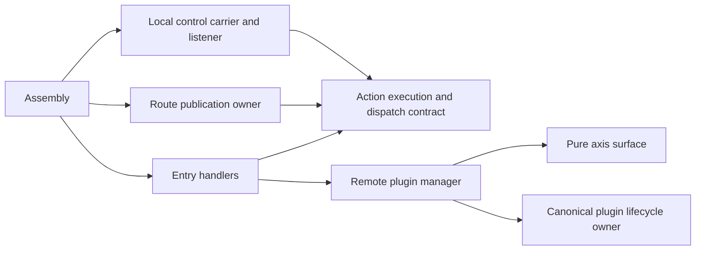

# Plugin control over local UDS

Entry routes requests to one or more axes. It has no shared/dedicated mounting
mode. A facility owns the listener, transport multiplexing and subscriptions.
Assembly selects facilities and registers entry handlers with them.

The source dependency direction is:



At runtime the facility invokes an injected handler. That call does not imply a
source dependency from the facility to the concrete entry. Worker controls and
plugin controls can use the same entry boundary. Each route selects its owning
use-flow and grant. Transport sharing does not merge those grants.

`src/entry/worker.rs` and `src/entry/plugins.rs` contain decoding and dispatch.
`src/assembly/control.rs` selects and connects the listener, route owner and
carrier. `action-execution` owns the actual invocation, cancellation and completion
pins, plus the injected `Dispatch` contract. Carriers receive that contract and do
not import the concrete route registry. `action-router` owns publication and
implements dispatch. Native Pingora still owns the proxy data path and notifier
order.

## Protocol choice

Plugin control uses ttrpc framing directly on a same-host Unix stream socket.
It does not use HTTP/2 or gRPC. The profile reuses the canonical 10-byte header,
Protobuf request/response envelope, request correlation, deadlines and status
codes. Unary and server-stream calls share one connection. Stream and request
queues are bounded. There is no automatic retry or invented cancellation frame.

The fixed service is `infra.control.v1.Actions`; the method is the registered
binding, such as `plugin.get` or `worker.metadata.v1.policy.routing`. The payload
retains the existing versioned, schema-checked JSON contract. It is opaque to the
carrier. The envelope is Protobuf; the JSON payload is not presented as a generated
Protobuf message. Contract bytes can also be consumed without RPC. This change
adds no payload conversion for each callback.

This selects the same-host framing described by the
[ttrpc protocol](https://github.com/containerd/ttrpc/blob/v1.2.10/PROTOCOL.md) and
[request schema](https://github.com/containerd/ttrpc/blob/v1.2.10/request.proto).
[Protobuf encoding](https://protobuf.dev/programming-guides/encoding/) remains
independent of transport. Ice's object dispatch and protocol machinery are not
needed for this bounded action carrier; its
[protocol description](https://docs.zeroc.com/ice/3.8/protocol/protocol-messages)
was reviewed rather than copied into a second stack. No measured throughput
advantage over gRPC or Ice is claimed.

## Facility selection

A separate plugin control facility needs only a UDS endpoint:

```json
{
  "upstream": "http://127.0.0.1:8080",
  "axis_bindings": {
    "request_policy": {
      "endpoint": "unix:///run/pingora-worker/policy.sock",
      "max_inflight": 32,
      "connect_timeout_ms": 5000,
      "shutdown_timeout_ms": 5000
    }
  },
  "plugin_ingress": {"listen": "unix:///run/pingora-worker/plugins.sock"},
  "callbacks": [{
    "axis": "request_policy",
    "registration": "policy",
    "package": "example.policy",
    "hooks": ["before_upstream_send"],
    "headers": ["x-request-id"],
    "patch_headers": ["x-policy"],
    "timeout_ms": 5000
  }]
}
```

To publish worker and plugin routes on the same local control facility:

```json
{
  "management": {
    "listen": "unix:///run/pingora-worker/control.sock",
    "protocol": "local_control"
  },
  "plugin_ingress": {"facility": "management"}
}
```

`axis_bindings.endpoint` selects the outbound provider. `plugin_ingress` selects
the incoming control facility. Neither creates a semantic axis. Omission of
`plugin_ingress` publishes no incoming plugin controls. The old `mount` field is
rejected. TCP plugin endpoints and sharing an HTTP management facility are also
rejected. Each native action must have at least one binding reachable through its
selected management carrier. Mixed bindings remain valid. A failed control
connection never silently falls back to gRPC or a local artifact.

Management defaults to the existing `http` facility for HTTP actions, SSE and
optional gRPC management clients. That independent facility is not the plugin
control path. Existing API-server mounts remain available for those carriers.
The local control service can mount on an already bound UDS listener; it cannot
be inserted into an HTTP router without an explicit protocol multiplexer.
Local socket permissions and deployment admission establish peer access. A
pathname or package name alone is not authentication.

| Binding selection | Result |
| --- | --- |
| Omitted or `remote` | Local ttrpc; requires an axis and registration |
| `direct` | Existing native or optional Wasm artifact path |
| `auto`, Rust or Go | Direct using the integrated native ABI bridge |
| `auto`, Python or JavaScript | Local ttrpc; interpreter owns its scheduler |

## Operations and custody

`plugin.get` takes `axis` and `registration`. It returns availability, contract,
manager incarnation and registration generation. `plugin.activate` also requires
the current incarnation. `plugin.withdraw` requires both incarnation and exact
generation. Unknown fields fail. These operations cannot install a new endpoint,
artifact, header grant or registration. Inputs and outputs are capped at 1 KiB.
The local server has 128 request slots, a 64 KiB carrier metadata cap and a
30-second maximum handler deadline; shorter client deadlines still apply.

The callback binding is `worker.metadata.v1.<registration>.<hook>`. Host projection
limits visible headers and metadata. Reply validation still checks version,
decision, header changes and protected fields. Unavailable slots fail closed.
Reactivation retains notifier position and grants. Replacement connects before
publication; failed replacement leaves the previous client active. Admitted calls
retain their previous transport generation.

One `plugin_lifecycle::coordination::memory::Coordinator` bounds assembled direct
and remote notifier buffers: 64 subscribers, 128 retained allocations and 8 MiB
reserved capacity. Serialization writes directly into a bounded buffer. Native
calls and owned remote exchanges retain custody beyond caller cancellation.
A local deadline is not remote completion. Shared-memory reclamation must never
use the end of a control wait as its witness.

## Physical shared memory is separate

The existing C profile uses same-kernel `SOCK_SEQPACKET` control and `SCM_RIGHTS`
for admitted FD bootstrap. Later records carry relative references with exact
resource, generation and lease coordinates. They carry no native pointers or
copied bulk body. Allocation, admission, peer release and local completion pins
belong to the plugin coordinator and memory provider, not this general carrier.

The Rust worker still lacks an adapter for that C arena profile. Its current UDS
control path carries owned metadata; it does not yet transfer shared-memory bulk
payloads. Changing the carrier does not close that integration gap.

## Validation limits

Real worker tests cover shared facility routes, separate facilities, stale controls,
fixed grants, replacement and cancelled requests with retained custody. Official
Go ttrpc v1.2.10 interoperability covers both directions, errors and server streams.
The Go harness ran externally; it is not yet a required cross-language CI test.

The checker retains uncertainty where semantic ownership, selected dependencies
or C/FFI build evidence is missing. The reviewed concrete carrier-to-`Router` dependency was removed by extracting
actual execution ownership and injecting its dispatch contract. This is a source
boundary change; runtime callback direction alone would not resolve the finding.
