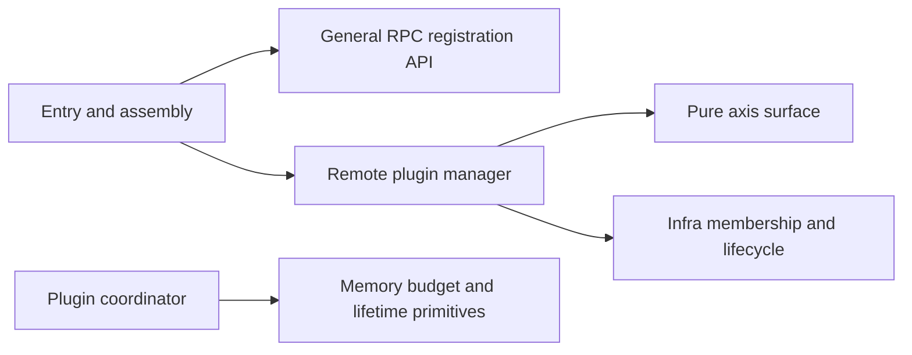
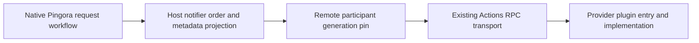

# Remote plugins and axis ingress

The entry dispatches plugin operations to their manager and axis surface. The
entry can also serve worker controls and explicit host Tool routes. These routes
keep their own use-flows and grants.

Source dependencies are:



At runtime the RPC facility delivers calls to registered entry handlers. That
callback does not create a source dependency from the facility to entry.
`network_actions::facility::RpcFacility` supports unary calls and multiple streaming
subscribers. It has no shared-memory, allocation or plugin coordination logic.
An API server can mount its bounded `grpc_service()`. The existing Axum mount
serves HTTP actions; it does not serve the generated gRPC API.

The previous implementation had only a map of outbound connections. That was not
a plugin manager. `RemotePluginManager` now owns installed participant identities,
issued hook grants, activation generations, withdrawal and retirement. It reuses
infra `PluginManager<T>`, which in turn reuses `Installation`, `Provider`, `Runtime`,
admission gates and inverse cleanup. The manager does not create another notifier
chain or change callback registration order.

The worker request path still uses native Pingora:



The pure axis surface selects only host-issued participants and hooks. Existing
metadata projection and reply validation enforce header grants and decisions for
both direct and remote bindings. The remote caller cannot widen either grant.

## Configuration

```json
{
  "upstream": "http://127.0.0.1:8080",
  "axis_bindings": {
    "request_policy": {
      "endpoint": "unix:///run/pingora-worker/policy.sock",
      "max_inflight": 32,
      "connect_timeout_ms": 5000,
      "shutdown_timeout_ms": 5000
    }
  },
  "plugin_ingress": {
    "listen": "unix:///run/pingora-worker/plugins.sock"
  },
  "callbacks": [{
    "axis": "request_policy",
    "registration": "policy",
    "package": "example.policy",
    "hooks": ["before_upstream_send"],
    "headers": ["x-request-id"],
    "patch_headers": ["x-policy"],
    "timeout_ms": 5000
  }]
}
```

`axis_bindings.endpoint` is the outbound provider endpoint. `plugin_ingress.listen`
is the optional incoming plugin control endpoint. They are different responsibilities.
Omitting `plugin_ingress` publishes no plugin controls. To share the existing
management listener, configure:

```json
{
  "management": {"listen": "unix:///run/pingora-worker/control.sock"},
  "plugin_ingress": {"mount": "management"}
}
```

The shared entry dispatches `worker.*` and `plugin.*` independently. With `listen`,
the plugin entry instead binds a dedicated local listener. A dedicated plugin
listener does not expose worker controls. Two listeners cannot bind the same
address; select `mount` when sharing. Data ingress remains separate. Unknown or
mixed mount/listen fields are rejected.

Both directions accept Unix sockets or loopback TCP. Deployment controls local
endpoint access and peer identity. Loopback alone does not authenticate a peer.
The listener reuses infra socket leases, route publication and `ActionListener`;
there is one authoritative listener for each configured operation.

| Binding selection | Result |
| --- | --- |
| Omitted or `remote` | RPC; requires a configured axis and registration |
| `direct` | Existing native or optional Wasm artifact path |
| Explicit `auto`, Rust or Go | Direct using the integrated native ABI bridge |
| Explicit `auto`, Python or JavaScript | RPC; the interpreter retains its own scheduler |

Existing native/Wasm entries must set `"binding": "direct"`. `backend: "native"`
selects an artifact backend, not a binding. A failed RPC connection never silently
loads a local artifact. A bridge tested elsewhere in infra does not establish a
working direct bridge inside this worker.

## Plugin operations

Both entry configurations reuse `infra.actions.v1.Actions/Call` with these bindings:

| Binding | Input | Effect |
| --- | --- | --- |
| `plugin.get` | `axis`, `registration` | Read publication availability, contract, manager incarnation and registration generation |
| `plugin.activate` | `axis`, `registration`, `incarnation` | Reinstall a host-declared, withdrawn slot with its original grant |
| `plugin.withdraw` | `axis`, `registration`, `incarnation`, `generation` | Fence the exact installed generation and drain its local calls |

All fields are JSON. Unknown fields are rejected. Controls cannot supply an
endpoint, artifact, hook list, header list or new registration. Input/output is
limited to 1 KiB. A dedicated plugin listener allows 32 concurrent calls and a
30-second local deadline. A shared mount uses the management carrier's aggregate
128-call capacity and 120-second deadline. The client's shorter deadline still
applies. Neither setting proves remote execution has ended.
Use `plugin.get` before a mutation. The random manager incarnation rejects controls
from a prior worker instance. The registration generation rejects withdrawal of a
replacement. These values are concurrency coordinates, not authentication secrets.

Callbacks fail closed while their selected slot is unavailable. Reactivation uses
the same notifier position and grants. `available: false` includes withdrawn,
warming, retiring or quarantined registrations; it is not a detailed lifecycle
report. A control timeout can have an unknown outcome. Query state before deciding
whether to retry; timeout does not undo a completed activation or withdrawal.

## Outbound provider contract and replacement

Providers expose `infra.actions.v1.Actions/Call` from their own plugin entry. The
binding is `worker.metadata.v1.<registration>.<hook>`. The input contains version,
hook, request ID, peer IP when present, method, path without query, status,
reuse/completion state, granted headers and selected network metadata. The reply
uses version 1 `decision`, `set_headers` and `remove_headers`. The host checks hook
support, decisions, versions, patch limits, header syntax and protected fields.
The configured package name is identity, not an authentication claim from the peer.

The metadata profile is capped at 64 KiB. It carries no bodies, streaming deltas,
shared-memory custody, socket FDs, pointers or borrowed native objects. Remote
message-codec grants remain rejected. Native Pingora owns body flow, connection
pooling, HTTP/2 keepalive and protocol parsing.

Host code can replace an outbound connection without changing membership:

```rust,ignore
proxy.remote_plugins()
    .replace("request_policy", "unix:///run/pingora-worker/policy-next.sock")
    .await?;
```

Replacement connects before publication. Failure leaves the previous client active.
Admitted calls retain their previous client. The replacement method is not exposed
by plugin ingress. It changes no registration identity, grant or notifier order.

Each callback pins a registration inside an owned async task until its local RPC
exchange settles. Dropping a caller does not release that pin early. Withdrawal
closes admission before draining. Shutdown retires plugin ingress, notifiers and
membership before releasing transports. Failed inverses remain retained and consume
capacity. Remote execution can outlive a local deadline; this implementation does
not claim remote cancellation, process join or shared-memory reclamation.

## Shared notifier memory coordination

Process assembly creates one `plugin_manager::memory::Coordinator` for direct and
RPC metadata callbacks. It admits at most 64 subscribers, 128 retained allocations,
and 8 MiB of reserved capacity. Each metadata frame reserves at most 64 KiB before
serialization. The writer grows only as needed and writes directly into its owned
buffer. There is no intermediate JSON value or buffer-to-buffer copy here.

The direct native callback holds its payload lease through actual native completion.
The remote adapter holds the lease in its owned exchange task. Cancelling the
waiting request does not release the reservation early. Shutdown retires notifiers
before the coordinator. These are process-local control buffers; the RPC transport
still encodes and transmits metadata. This does not implement bulk shared memory
or prove that a remote peer stopped using other resources after a deadline.

Full plugin managers and Tool-provider managers have different jobs. The reusable
infra manager can compose Tool providers with a full plugin, while a host can use
the Tool manager alone. The worker's existing native action publication remains an
explicit host binding. Full Tool implementations and policy/decoder/encoder adapters
use governed ports; choosing direct native or RPC delivery does not widen those ports.

## Source ownership and validation limits

The plugin entry decodes wire values. The worker manager owns plugin operations and
interprets configuration. The surface owns pure publication selection. Infra owns
membership lifecycle, transport generations, action routing and socket lifecycle.
Async actions share the existing router's validation and owned-call boundary;
native synchronous actions retain their blocking execution path.

This corrects the previous host-entry guidance using the supplied export 7 design
discussions. These documents are design inputs, not execution evidence. The current
integration tests exercise shared and separate real Unix sockets, withdrawal/reactivation,
stale incarnation and generation rejection, fixed grants, dynamic connection
replacement and rollback. They do not establish throughput or remote authorization.

Remaining limits include no worker bulk shared-memory binding, no provider capability negotiation, no authenticated
cross-host transport, no bulk RPC/shared-memory binding, no full lifecycle state
API, and no measured production throughput or tail latency. Native libraries remain
trusted host code. Checker ownership declarations cannot prove these runtime
properties without source and execution evidence.
